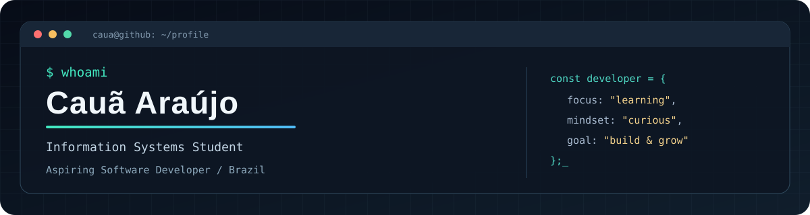

 

**Software Development Internships · Web Development · Continuous Learning**

## `> about_me`

I'm **Cauã Araújo**, an **Information Systems undergraduate at UNINASSAU**, based in Pernambuco, Brazil. I'm interested in software development and building practical, user-friendly applications.

Through academic and collaborative projects, I've worked on **web interfaces** and contributed to application logic. I'm developing my programming foundations and looking for an **internship opportunity** where I can learn from a team, contribute to real projects, and grow as a developer.

- **Current focus:** Python, HTML, CSS, and software development fundamentals
- **Working knowledge:** Angular, TypeScript, and Ionic (basic)
- **Also studying:** Java, object-oriented programming, data structures, and databases
- **English:** Advanced

## `> tech_stack`

**Programming & web fundamentals**

**Frameworks & tools I've used in academic projects — basic proficiency**

## `> featured_projects`

<table>
<tr>
<td width="50%" valign="top">

### [AngularUniversity](https://github.com/CauaAraujo0/AngularUniversity)

Responsive web application for exploring universities around the world, with country-based search and a user-friendly interface.

**My contribution:** Implemented interface screens.

**Project stack:** Angular, TypeScript, Bootstrap.

[View repository →](https://github.com/CauaAraujo0/AngularUniversity)

</td>
<td width="50%" valign="top">

### [WebTickets](https://github.com/CauaAraujo0/Web_Tickets)

Academic queue-management system for medical laboratories, including ticket issuance, service counters, and priority rules.

**My contribution:** Helped implement the ticket-management logic.

**Project stack:** Ionic, Angular, TypeScript.

[View repository →](https://github.com/CauaAraujo0/Web_Tickets)

</td>
</tr>
</table>

## `> github_activity`

> Language statistics reflect repository code, not proficiency levels. This card is provided by a third-party service and may be temporarily unavailable.

## `> connect`

I'm open to conversations about **internship opportunities, collaborative projects, and software development**.

- **GitHub:** [github.com/CauaAraujo0](https://github.com/CauaAraujo0)
- **Email:** [Get in touch](mailto:araujo.caua2006@gmail.com)

---

Learning, building, and improving — one commit at a time.

